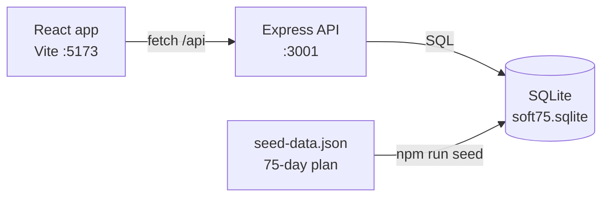
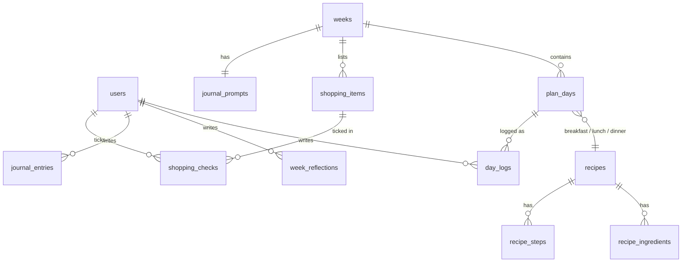

# 🌸 75 Soft Studio

A full-stack web app for tracking the **75 Soft** wellness challenge: four daily rituals, a 75-day meal plan with recipes, workouts, a reading plan, weekly shopping lists, Sunday reflections, a junk journal and progress stats.

Built by **Ramla Hussein** as a portfolio project.

 

## Features

- **Today**: tick off Nourish, Move 45 minutes, Water (12 × 250 ml glasses) and Read 10 pages, plus a bonus "Brainstack" activity. Shows the day's workout, pages to read, affirmation and milestone treats.
- **Meal plan**: breakfast, lunch and dinner for every day, linked to 43 recipes with ingredients and method.
- **75-day grid**: every day coloured by how many rituals were done.
- **Progress**: totals, perfect days, current and best streaks, a daily chart and per-ritual bars, all calculated with SQL.
- **Weekly**: an auto-generated shopping list grouped by aisle (with saved ticks) and a Sunday reflection.
- **Junk journal**: 11 weekly creative prompts with notes and a "page finished" tick.
- **Recipe book**: search by name or ingredient and filter by meal.

## Tech stack

| Layer | Technology | Why |
|---|---|---|
| Front end | React 18, Vite, plain CSS with design tokens | Component-based UI, fast dev server, light and dark themes |
| Back end | Node.js, Express 5 | A small REST API with central error handling |
| Database | SQLite (better-sqlite3) | A real relational database with no setup: one file |
| Testing | Vitest, Supertest, Testing Library | API tests against an in-memory database, plus component tests |
| CI | GitHub Actions | Runs the tests and build on every push |

## Architecture



In development, Vite proxies `/api` calls to Express. In production, Express serves the built React app and the API from one server.

## Database design

The schema (`server/db/schema.sql`) separates the **plan** (seeded, read-only) from the **logs** (what the user actually did).



Things worth pointing out:

- **Constraints in the database**: `CHECK` rules keep data valid (water is 0–12, mood is one of four values, ticks are 0 or 1), and foreign keys keep references consistent.
- **Upserts**: saving a day uses `INSERT … ON CONFLICT DO UPDATE`, so the first tick creates the row and later ticks update only the fields sent.
- **A SQL view**: `day_scores` works out each day's points, with water counting only at 12 glasses. The progress endpoint builds its totals from it.
- **Transactions**: seeding the 75-day plan runs in a single transaction.

## API

| Method | Endpoint | What it does |
|---|---|---|
| GET | `/api/health` | Health check |
| GET | `/api/days/:day` | The plan for a day (meals, workout, reading, affirmation, milestone) |
| GET | `/api/recipes?meal=&q=` | Search recipes by name or ingredient |
| GET | `/api/recipes/:id` | One recipe with ingredients and method |
| GET | `/api/logs/days` | All logged days |
| GET | `/api/logs/days/:day` | One day's ticks, mood and note |
| PATCH | `/api/logs/days/:day` | Update any of: `nourish`, `move`, `read`, `brain`, `water`, `mood`, `note` |
| GET | `/api/weeks/:week` | Shopping list with ticks, the week's recipes and reflection |
| PUT | `/api/weeks/:week/shopping/:itemId` | Tick or untick a shopping item (`{ "checked": true }`) |
| PATCH | `/api/weeks/:week/reflection` | Save reflection answers |
| GET | `/api/journal` | All 11 journal prompts with notes |
| PATCH | `/api/journal/:week` | Save a journal note or mark the page finished |
| GET | `/api/progress?today=YYYY-MM-DD` | Totals, perfect days, streaks and points per day |

Every input is validated. Bad requests get a `400` with a plain-English message, for example `{"error": "water must be a whole number from 0 to 12."}`.

## Run it locally

You need [Node.js](https://nodejs.org) 20 or newer.

```bash
npm run setup   # install packages and create the database with the 75-day plan
npm run dev     # start the API (port 3001) and the React app (port 5173)
```

Then open http://localhost:5173.

Other commands:

```bash
npm test        # run all tests (API and front end)
npm start       # build the React app and serve everything from http://localhost:3001
```

## Project structure

```
soft75/
├── server/
│   ├── db/
│   │   ├── schema.sql        # tables, constraints, view and indexes
│   │   ├── seed-data.json    # the 75-day plan, recipes, shopping lists, prompts
│   │   └── seed.js
│   ├── src/
│   │   ├── app.js            # Express app (routes, error handling)
│   │   ├── db.js             # opens the database and seeds it
│   │   ├── stats.js          # day numbers and streak logic
│   │   ├── validate.js       # input validation helpers
│   │   └── routes/           # plan, logs, weeks, journal, progress
│   └── test/api.test.js      # 15 API tests
├── client/
│   └── src/
│       ├── App.jsx           # tabs and routing
│       ├── api.js            # fetch wrapper
│       ├── pages/            # Today, Plan, Progress, Weekly, Journal, Recipes
│       └── components/       # RitualCard, ProgressDial, RecipeModal
└── .github/workflows/ci.yml
```

## Testing

- **API tests** (Vitest and Supertest) run every endpoint against a fresh in-memory database: saving and scoring days, validation errors, shopping ticks that can't cross weeks, reflections, journal and progress maths.
- **Unit tests** cover the streak logic, including the rule that an unfinished "today" doesn't break a streak.
- **Component tests** (Testing Library) check that ritual cards toggle by click and keyboard, and that the recipe page calls the API with the right filters.

## What I would add next

- User accounts with secure sign-in (the API already scopes every query by `user_id`)
- Reminders to drink water and read
- Deployment to a cloud host with PostgreSQL
- End-to-end tests with Playwright
- An offline-first mobile version (PWA)
